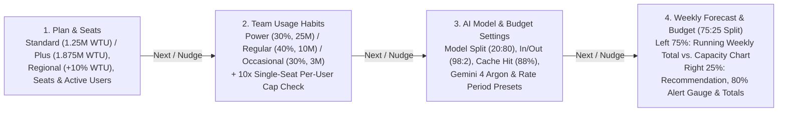

# Antigravity in Gemini Enterprise Usage Simulator

**Self link:** [go/agy-ge-usage-simulator](http://goto.google.com/agy-ge-usage-simulator)  
**Visibility:** Confidential  
**Status:** Draft  
**Authors:** [Mohan Sridharan](mailto:mohansridharan@google.com)  
**Contributors:** N/A  
**Team:** Google Cloud — JAPAC AI & Agentic Coding Enablement  
**PRD:** This document (PRD and design combined)  
**Tracking Buganizer issue/hotlist:** N/A  
**Last major revision:** 2026-10-28

---

# Context

## Objective

Provide Customer Engineers (CEs), Solution Architects, and enterprise IT administrators with a self-contained, interactive browser-based **Antigravity in Gemini Enterprise Usage Simulator** (**Pushpak**) that models weekly **Weighted Token Unit (WTU)** and token capacity alongside developer consumption across the working week (`Monday`–`Friday`).

The simulator answers four operational questions across four dedicated tabs (`1. Plan & Seats` $\rightarrow$ `2. Team Usage Habits` $\rightarrow$ `3. AI Model & Budget Settings` $\rightarrow$ `4. Weekly Forecast & Budget`), guided by a **step-by-step wizard** that presents two floating buttons (**Back** and **Next**) on the UI and triggers a **UI nudge** prompting the user to advance to the next screen whenever fields in the current tab are updated:

1.  **1. Plan & Seats:** Given the customer's **Gemini Enterprise Plan** (`Standard` at \$10/seat/mo = \$2.50/wk = `1.25M WTU/seat/wk`, or `Plus` at \$15/seat/mo = \$3.75/wk = `1.875M WTU/seat/wk`, where `1M WTU = $2.00`), **Endpoint Location** (`Global` vs. `Regional +10% WTU`), **Total Purchased Seats** ($N_{\text{licenses}}$), and **Active Antigravity Users** ($N_{\text{AGY}} \le N_{\text{licenses}}$), what are the **Total Weekly Team Capacity** (in cache-inclusive tokens and WTUs) and **Average Weekly Capacity per Active User**?
2.  **2. Team Usage Habits:** How does splitting active Antigravity users across **Power Users (Heavy)**, **Regular Users (Moderate)**, and **Occasional Users (Light)** (default `30%–40%–30%`) with configurable cache-inclusive **Estimated Weekly Usage per Person** (default `Power: 25M`, `Regular: 10M`, `Occasional: 3M` tokens/user/week) impact **Total Estimated Team Usage / Week**, and does any Power User exceed the unpooled **10× single-seat per-user weekly cap** (`18.75M WTU` = \$37.50/wk on `Plus`; `12.50M WTU` = \$25.00/wk on `Standard`)?
3.  **3. AI Model & Budget Settings:** How do the **AI Model Split** (`Gemini 4 Argon` vs. `Gemini 3.8 Flash`, default `20:80`), the **Prompt vs. Response Ratio (Input vs. Output + Thinking)** (default `98% Input / 2% Output`), the **Context Cache Hit Rate (%)** (default `88%`, where cached prompt tokens cost `5%` of uncached input on `Gemini 4 Argon` and `10%` on `Gemini 3.8 Flash`), **Extra Monthly Budget (Optional)** (default \$0), **Rate Period Presets** (`Current Promo` to Nov 30, 2026; `Dec 2026`; `Jan 2027+`), and independent model **Discount (%)** widgets shift the **Overall Blended Cost & WTU Weight** (`$/1M tokens` and `WTU / 1K tokens`)?
4.  **4. Weekly Forecast & Budget:** In a **75:25 vertical split**, how does the **Running Weekly Total** of team usage across `Occasional`, `Regular`, and `Power` users track against the **Weekly Capacity Limit** from `Monday` to `Friday`, when does usage cross the official **80% admin notification threshold**, and what **Recommendation & Budget Status** (`Sufficient Capacity Available`, `Optimal Capacity Match`, or `Additional Budget Needed` with **Estimated Extra Monthly Overage Budget Needed (Opt-In)**) is triggered?

## Background

When enterprise customers procure **Gemini Enterprise Standard** (\$10/user/month AI credit allocation = `1.25M WTU / seat / week`) or **Gemini Enterprise Plus** (\$15/user/month AI credit allocation = `1.875M WTU / seat / week`), Antigravity IDE and CLI usage draws from a shared, project-level **Weighted Token Unit (WTU)** quota pool (`aiusage.googleapis.com/gemini_enterprise_Included_weekly_quota_per_project`) that refreshes weekly and does not roll over.

Key production quota mechanics (`wtu.go`):

-   **WTU Conversion (`1M WTU = $2.00`):** Every model call is metered into WTUs using three distinct token buckets—**Uncached Input** ($\text{prompt} - \text{cached}$), **Cached Input** ($\text{cached}$), and **Output + Thinking** ($\text{candidates} + \text{thoughts}$):
    $$\text{WTU} = (\text{prompt} - \text{cached}) \cdot w_{\text{in}} + \text{cached} \cdot w_{\text{cache}} + (\text{candidates} + \text{thoughts}) \cdot w_{\text{out}}$$
-   **Context Caching in Agentic Coding:** Because Antigravity re-sends repository context and conversation history on every turn (`~65K–69K` prompt tokens vs. `~550` response + thinking tokens per call, or `~98% Input / 2% Output`), roughly **`88%`** of prompt tokens are served from context cache at **`5%`** of uncached input weight on `Gemini 4 Argon` and **`10%`** on `Gemini 3.8 Flash`. Ignoring context caching overstates per-token quota burn by ~6×.
-   **10× Single-Seat Per-User Cap & Opt-In Overage:** All purchased seats on a GCP project (including unassigned licenses) pool together, but an individual user cannot consume more than **10× a single seat's weekly WTU allocation** (`18.75M WTU` = \$37.50/wk on `Plus`; `12.50M WTU` = \$25.00/wk on `Standard`) unless PAYG overage is enabled. Admins receive an automated alert at **80%** pool consumption, and overage never auto-activates (requests beyond pool or per-user cap return HTTP 429 unless an admin opts in).

---

# Requirements

## Information architecture

## User stories

Persona: a Google Cloud Customer Engineer (CE), procurement lead, or business/IT administrator modeling Antigravity capacity.

1.  **As an admin on 1. Plan & Seats,** I select `Standard` (`1.25M WTU / $2.50 per seat/wk`) or `Plus` (`1.875M WTU / $3.75 per seat/wk`) under **Gemini Enterprise Plan**, optionally toggle **Regional Endpoint (+10% WTU)** for non-global endpoints, and enter **Total Purchased Seats** and **Active Antigravity Users** ($\le$ Total Purchased Seats), while the right pane displays **Total Weekly Team Capacity** (in tokens and WTU pool) and **Average Weekly Capacity per Active User**; once I update any field, a floating UI nudge prompts me to click **Next** to move to **2. Team Usage Habits**.
2.  **As an admin on 2. Team Usage Habits,** I configure the **Team Activity Breakdown (%)** across `Power Users (Heavy)`, `Regular Users (Moderate)`, and `Occasional Users (Light)` (default `30%–40%–30%`) and their cache-inclusive **Estimated Weekly Usage per Person** (default `25M`, `10M`, `3M` tokens/user/week), while an inline indicator verifies whether a Power User's weekly usage stays within the unpooled **10× single-seat per-user limit** (`18.75M WTU` on `Plus`, `12.50M WTU` on `Standard`).
3.  **As an admin on 3. AI Model & Budget Settings,** I configure the **AI Model Split** (`Gemini 4 Argon` vs. `Gemini 3.8 Flash`, default `20% / 80%`), the **Prompt vs. Response Ratio** (`98% Input / 2% Output + Thinking`), the **Context Cache Hit Rate** (`88%` cached prompts), the **Extra Monthly Budget (Optional)** (default \$0), and choose from three one-click **Rate Period Presets** (`Current Promo` through Nov 30, 2026; `Dec 2026`; `Jan 2027+ Standard Rates`) or custom model discounts.
4.  **As an admin on 4. Weekly Forecast & Budget,** I see a **75:25 vertical split** where the left 75% pane displays the **Weekly Team Usage vs. Available Capacity** (**Running Weekly Total**) stacked line chart prominently at the top and a merged header + legend card below, while the right 25% pane places the **Recommendation & Budget Status** (with opt-in overage guidance) and **Weekly Capacity Used (%)** (highlighting `Near Limit` at the official **80%** alert threshold) at the top, followed by **Total Weekly Capacity Available** and **Total Weekly Team Usage**.

## Functional requirements

ID | Tab | Requirement | Priority
--- | --- | --- | ---
R1 | Global | **Fixed Header, Scrollable Content, Light/Dark Mode Toggle, Plain-English Labels & Colored Tab Borders:** Defaults to Dark Mode and provides a segmented **Dark / Light Mode Toggle** in the top-right header. Uses clear, business-friendly labels across four top-level tabs ordered as: **1. Plan & Seats**, **2. Team Usage Habits**, **3. AI Model & Budget Settings**, and **4. Weekly Forecast & Budget**. | P0
R1a | Global Wizard | **Floating Back & Next Wizard Buttons + Field-Update UI Nudge:** Renders floating **Back** and **Next** navigation buttons in the bottom-right corner and triggers an animated **UI nudge** whenever any control is updated. | P0
R2 | 1. Plan & Seats | **Plan Selection (with WTU Pool & 10× User Cap), Regional Endpoint Toggle, Purchased Seats & Active Users:** Left 2/3rd pane places **Gemini Enterprise Plan** radio buttons (`Standard` at \$10/mo = \$2.50/wk = `1.25M WTU/wk` per seat; `Plus` at \$15/mo = \$3.75/wk = `1.875M WTU/wk` per seat) and a **Regional Endpoint (+10% WTU)** toggle at the top, followed below by **Total Purchased Seats** (noting all seats pool together, including unassigned licenses) and **Active Antigravity Users** ($\le$ Total Purchased Seats). | P0
R3 | 1. Plan & Seats | **Available Weekly Capacity Display (+6px Font):** Right 1/3rd pane displays readonly values styled `+6px` larger than normal text for (a) **Total Weekly Team Capacity** (tokens and total WTU pool) and (b) **Average Weekly Capacity per Active User**, plus summary rows for **Active Users / Purchased Seats**, **Weekly Included Pool (WTU / USD)**, and **Effective Cost per 1M Tokens (w/ Cache)** in both `$/1M` and `WTU/1K`. | P0
R4 | 2. Team Usage Habits | **Team Activity Breakdown (%), Cache-Inclusive Weekly Usage per Person & 10× Per-User Cap Warning:** Collects (a) the `%` of users in **Power Users (Heavy)**, **Regular Users (Moderate)**, and **Occasional Users (Light)** (`30-40-30` default) and (b) cache-inclusive **Estimated Weekly Usage per Person** (`M tokens/user/week`), defaulting to **Power: 25M**, **Regular: 10M**, and **Occasional: 3M**. Displays an inline check and warning if Power User weekly usage exceeds the unpooled **10× single-seat per-user weekly limit** (`18.75M WTU` on `Plus`, `12.50M WTU` on `Standard`). | P0
R5 | 3. AI Model & Budget Settings | **Top 4-Card Row — AI Model Split, Prompt vs. Response Ratio, Context Cache Hit Rate & Extra Monthly Budget:** Provides (1) **AI Model Split** (`20% Gemini 4 Argon / 80% Gemini 3.8 Flash` default), (2) **Prompt vs. Response Ratio** (`98% Input / 2% Output + Thinking` default), (3) **Context Cache Hit Rate** (`88%` default, showing the resulting `11.8% uncached · 86.2% cached · 2.0% out` token bucket breakdown), and (4) **Extra Monthly Budget (Optional)** (`$ / month`, default \$0). | P0
R6 | 3. AI Model & Budget Settings | **Model Rates (`Gemini 4 Argon` & `Gemini 3.8 Flash`), Rate Period Presets & Discounts:** Models **Gemini 4 Argon** (\$4.00/1M Uncached In, \$0.20/1M Cached In [`5%` weight], \$20.00/1M Out list; `50%` launch promo through Nov 30, 2026) and **Gemini 3.8 Flash** (\$1.50/1M In, \$0.15/1M Cached In [`10%` weight], \$7.50/1M Out list; `50%` promo through Dec 31, 2026). Provides 3 one-click **Rate Period Presets** (`Current Promo`, `Dec 2026`, `Jan 2027+`). | P0
R7 | 4. Weekly Forecast & Budget | **75:25 Vertical Split — Left 75% Graph Pane:** Places the interactive stacked line chart (`Monday`–`Friday`) at the top of the left 75% pane with a merged header + legend card and daily breakdown table below. | P0
R8 | 4. Weekly Forecast & Budget | **75:25 Vertical Split — Right 25% Infographics Pane (80% Alert Threshold):** Places four vertical infographics in the right 25% pane: (1) **Recommendation & Budget Status**, (2) **Weekly Capacity Used (%)** (triggering `Near Limit` at $\ge 80\%$ to match the official GE admin alert threshold, and noting `HTTP 429 w/o Opt-In` above `100%`), (3) **Total Weekly Capacity Available**, and (4) **Total Weekly Team Usage**. | P0
R9 | 4. Weekly Forecast & Budget | **Recommendation & Opt-In Overage Budget Status:** Evaluates **Total Weekly Capacity Available** ($A$) vs. **Total Weekly Team Usage** ($U$): `Optimal Capacity Match` within $\pm 5\%$, `Sufficient Capacity Available` when $A > U$, and `Additional Budget Needed` when $A < U$, displaying the **Estimated Extra Monthly Overage Budget Needed (Opt-In)** ($\Delta S_{\text{mo}} = 4 \times (U - A) \times \text{Cost}_{\text{Blended}}$) and noting that overage requires explicit admin opt-in. | P0

---

# Design

## Mathematical model (WTU & Context Caching)

Let:

-   $N_{\text{licenses}}$ = Total procured Gemini Enterprise licenses (`1. Plan & Seats` tab; all seats pool together, including unassigned seats)
-   $N_{\text{AGY}} \le N_{\text{licenses}}$ = Active Antigravity users consuming quota (`1. Plan & Seats` tab)
-   $Q_{\text{license,wk}} \in \{\$2.50, \$3.75\}$ = Weekly per-license credit (`Standard` = \$2.50/wk = `1.25M WTU`, `Plus` = \$3.75/wk = `1.875M WTU`, at `1M WTU = $2.00`)
-   $\rho_{\text{reg}} \in \{1.00, 1.10\}$ = Endpoint location multiplier (`Global` = $1.00$, `Regional` = $1.10$)
-   $S_{\text{add,mo}} \ge 0$ (default $\$0$) = **Extra Monthly Budget**, contributing $S_{\text{add,wk}} = S_{\text{add,mo}} / 4$ per week
-   $m_{\text{Argon}}, m_{\text{Flash}} \in [0, 1]$ ($m_{\text{Argon}} + m_{\text{Flash}} = 1$, default $0.20, 0.80$) = **AI Model Split**
-   $r_{\text{in}}, r_{\text{out}} \in [0, 1]$ ($r_{\text{in}} + r_{\text{out}} = 1$, default $0.98, 0.02$) = **Prompt vs. Response (+ Thinking) Ratio**
-   $c_{\text{hit}} \in [0, 0.98]$ (default $0.88$) = **Context Cache Hit Rate** (share of prompt tokens served from cache)
-   $\alpha_{\text{cache,Argon}} = 0.05$, $\alpha_{\text{cache,Flash}} = 0.10$ = Cached input weight relative to uncached input (`5%` on `Gemini 4 Argon`; `10%` on `Gemini 3.8 Flash`)
-   $d_{\text{Argon}}, d_{\text{Flash}} \in [0, 0.90]$ (default $0.50, 0.50$ under `Current Promo`) = Promotional or negotiated discount percentages

### 1. Token bucket shares & effective blended rate (\$/1M tokens and WTU / 1K tokens)

$$s_{\text{uncached}} = r_{\text{in}} \cdot (1 - c_{\text{hit}}), \quad s_{\text{cached}} = r_{\text{in}} \cdot c_{\text{hit}}, \quad s_{\text{out}} = r_{\text{out}}$$

For each model family $k \in \{\text{Argon}, \text{Flash}\}$:

$$\text{Cost}_k = \rho_{\text{reg}} \cdot (1 - d_k) \cdot \Big[ \big(s_{\text{uncached}} + s_{\text{cached}} \cdot \alpha_{\text{cache},k}\big) \cdot P_{k,\text{in}} + s_{\text{out}} \cdot P_{k,\text{out}} \Big]$$

$$\text{Cost}_{\text{Blended}} = m_{\text{Argon}} \cdot \text{Cost}_{\text{Argon}} + m_{\text{Flash}} \cdot \text{Cost}_{\text{Flash}}, \quad \text{WTU per 1K Tokens} = \frac{\text{Cost}_{\text{Blended}}}{2.00} \times 1000$$

At default settings (`20% Argon [50% off] / 80% Flash [50% off]`, `98% Input / 2% Output`, `88% Cache Hit`, `Global` endpoint):

-   $\text{Cost}_{\text{Argon}} = 0.1176(\$2.00) + 0.8624(\$0.10) + 0.02(\$10.00) = \$0.5214 / \text{1M tokens}$ (`260.7 WTU / 1K tokens`)
-   $\text{Cost}_{\text{Flash}} = 0.1176(\$0.75) + 0.8624(\$0.075) + 0.02(\$3.75) = \$0.2279 / \text{1M tokens}$ (`113.9 WTU / 1K tokens`)
-   $\text{Cost}_{\text{Blended}} = 0.20(\$0.5214) + 0.80(\$0.2279) = \mathbf{\$0.2866 / \text{1M tokens}}$ ($\mathbf{143.3\text{ WTU / 1K tokens}}$, or $\mathbf{3.49\text{M tokens per }\$1.00}$)

### 2. Weekly token availability, 10× per-user cap & opt-in overage budget

$$\text{License Weekly Tokens (M)} = \frac{N_{\text{licenses}} \times Q_{\text{license,wk}}}{\text{Cost}_{\text{Blended}}}, \quad \text{Additional Weekly Tokens (M)} = \frac{S_{\text{add,mo}} / 4}{\text{Cost}_{\text{Blended}}}$$

$$\text{Single-Seat 10}\times\text{ Per-User Weekly Limit (M)} = \frac{10 \times Q_{\text{license,wk}}}{\text{Cost}_{\text{Blended}}}$$

When Weekly Token Availability $A < U$ (where $U = W_L + W_M + W_H$ is total weekly token usage), the indicative monthly opt-in overage budget required is:

$$\text{Estimated Extra Monthly Overage Budget (\$ / mo)} = 4 \times (U - A) \times \text{Cost}_{\text{Blended}}$$

## Production WTU & Pricing Reference Table (`wtu.go`)

Model Family | Uncached Input (\$/1M · WTU/tok) | Cached Input (\$/1M · WTU/tok) | Output + Thinking (\$/1M · WTU/tok) | Promo Window
--- | --- | --- | --- | ---
**Gemini 4 Argon (50% Promo)** | \$2.00 (`1.00`) | \$0.10 (`0.05`, 5% wt) | \$10.00 (`5.00`) | Launch promo through **Nov 30, 2026**
**Gemini 4 Argon (Standard)** | \$4.00 (`2.00`) | \$0.20 (`0.10`, 5% wt) | \$20.00 (`10.00`) | Effective **Dec 1, 2026+**
**Gemini 3.8 Flash (50% Promo)** | \$0.75 (`0.375`) | \$0.075 (`0.0375`, 10% wt) | \$3.75 (`1.875`) | Promo through **Dec 31, 2026**
**Gemini 3.8 Flash (Standard)** | \$1.50 (`0.75`) | \$0.15 (`0.075`, 10% wt) | \$7.50 (`3.75`) | Effective **Jan 1, 2027+**
